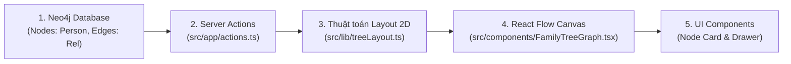

# CƠ CHẾ VẼ & RENDER CÂY GIA PHẢ KỸ THUẬT SỐ (24 - 25 ĐỜI)

Tài liệu này giải thích chi tiết kiến trúc và luồng xử lý từ cơ sở dữ liệu đồ thị **Neo4j** đến giao diện tương tác **React Flow** trên ứng dụng Cây Gia Phả.

---

## 🗺️ 1. Kiến trúc tổng thể (High-Level Architecture)

Hệ thống hoạt động theo mô hình 4 tầng phân tách rõ ràng:



---

## 🔍 2. Chi tiết từng tầng xử lý

### Bước 1: Lưu trữ & Chuẩn hóa dữ liệu từ Neo4j (`actions.ts`)

#### A. Cấu trúc lưu trữ trong Neo4j
- **Node `(:Person)`**:
  - `id`: Mã định danh duy nhất (ví dụ: `P_D01`, `P_D18_CON`...)
  - `full_name`: Họ và tên
  - `gender`: Giới tính (`MALE`, `FEMALE`)
  - `generation`: Thế hệ / Đời (từ Đời 1 đến Đời 25)
  - `title`, `alias_name`, `birth_year`, `lunar_death_day`, `hometown`, `biography`, `note`, `is_alive`...
- **Relationships**:
  - `(:Person)-[:FATHER_OF]->(:Person)`: Quan hệ Cha - Con
  - `(:Person)-[:MOTHER_OF]->(:Person)`: Quan hệ Mẹ - Con
  - `(:Person)-[:MARRIED_TO]->(:Person)`: Quan hệ Vợ - Chồng (kèm thuộc tính `marriage_order: 1, 2...`)

#### B. Hàm truy vấn (`getFamilyTree()`)
Server Action thực thi Cypher Query để chuẩn hóa dữ liệu:
1. **Chuẩn hóa thông tin Node**:
   - Tự động fallback giữa `full_name` và `name`.
   - Chuẩn hóa giới tính thành chữ thường (`male`, `female`, `other`).
   - Lấy trường `generation` (mặc định 1 nếu thiếu).
2. **Chuẩn hóa quan hệ**:
   - Gom `FATHER_OF`, `MOTHER_OF` thành quan hệ logic `PARENT_OF`.
   - Gom `MARRIED_TO` thành quan hệ logic `SPOUSE_OF`.

---

### Bước 2: Thuật toán bố cục toạ độ 2D (`treeLayout.ts`)

Hàm `calculateTreeLayout(members, relationships, activeId)` là **trái tim tính toán toạ độ $(X, Y)$** cho từng node trên không gian 2D:

#### A. Phân tầng theo trục dọc $Y$ (Thế hệ / Đời):
Các thành viên trong cùng một đời có cùng toạ độ $Y$. Mỗi đời cách nhau một khoảng $260\text{px}$:
$$Y = (\text{generation} - \text{minGen}) \times 260\text{px}$$

- **Đời 1**: $Y = 0\text{px}$
- **Đời 2**: $Y = 260\text{px}$
- **Đời 3**: $Y = 520\text{px}$
- ...
- **Đời 25**: $Y = 6240\text{px}$

#### B. Sắp xếp trục ngang $X$ & Ghép cặp Vợ - Chồng:
- Duyệt qua từng thành viên trong cùng 1 đời.
- Nếu thành viên có liên kết `SPOUSE_OF`, thuật toán sẽ **gom cụ ông và các cụ bà đứng liền kề nhau** (hỗ trợ đa thê như Cụ Đời 18 Đinh Danh Côn với Bà Cả & Bà Hai).
- Tính toán tổng chiều rộng thế hệ và căn đều hai bên trục giữa ($X = 0$) để toàn bộ cây cân đối:
  $$X = \text{startX} + \text{index} \times \text{nodeWidth} + \frac{\text{nodeWidth}}{2} - 120\text{px}$$

#### C. Định tuyến đường nối (Edges Routing):
1. **Đường Vợ - Chồng (`SPOUSE_OF`)**:
   - Cổng nối: Từ `right` (cạnh phải chồng) sang `left` (cạnh trái vợ).
   - Kiểu vẽ: `straight` (đường thẳng), nét đứt (`strokeDasharray: '4 4'`), màu hồng `#ec4899`.
2. **Đường Cha/Mẹ - Con (`PARENT_OF`)**:
   - Cổng nối: Từ `child-source` (đáy cha/mẹ) sang `parent-target` (đỉnh con).
   - Kiểu vẽ: `smoothstep` (đường cong vuông góc mượt mà), màu xám bạc `#94a3b8`.

---

### Bước 3: Canvas hiển thị tương tác (`FamilyTreeGraph.tsx`)

Sử dụng thư viện chuyên dụng **`@xyflow/react` (React Flow)**:
- **Infinite Canvas**: Hỗ trợ cuộn chuột để Zoom in/out toàn bộ 25 đời, giữ chuột kéo (Pan) tự do trên màn hình.
- **Minimap (Bản đồ radar thu nhỏ)**: Góc dưới bên phải giúp định vị nhanh cụm thế hệ đang xem (Nam màu xanh lam, Nữ màu hồng).
- **Controls Bar**: Các nút phóng to, thu nhỏ, khoá khung nhìn và tự động căn vừa màn hình (`fitView`).
- **Thanh tìm kiếm (MemberSearch)**: Tìm kiếm tức thì theo tên, tước hiệu, tên tự và tự động di chuyển camera (`setCenter`) đến đúng node đó.

---

### Bước 4: Card hiển thị Node tùy biến (`FamilyMemberNode.tsx`)

Mỗi Node trên cây là một React Component tùy biến:
- **Màu sắc nhận diện**:
  - **Nam**: Nền & viền xanh dương (`border-blue-400`, `bg-blue-50`).
  - **Nữ**: Nền & viền hồng (`border-rose-400`, `bg-rose-50`).
- **Badge thế hệ**: Góc trên bên phải hiển thị rõ `Đời 1` đến `Đời 25`.
- **Thông tin tóm tắt trên Card**:
  - Avatar / Ký tự viết tắt họ tên.
  - Họ và tên, Năm sinh/mất (hoặc "Còn sống" / "Đã mất").
  - Tước hiệu / Nghề nghiệp.
- **Điểm kết nối (Handles)**:
  - Đỉnh (`Top`): Cổng nhận từ cha mẹ.
  - Đáy (`Bottom`): Cổng truyền xuống con cái.
  - Hai bên (`Left`, `Right`): Cổng nối vợ chồng.

---

### Bước 5: Chi tiết thành viên & Quan hệ gia đình (`MemberDrawer.tsx` & `MemberInfoView.tsx`)

Khi click vào bất kỳ Node nào:
1. **Thông tin chi tiết**:
   - Họ tên, tên tự, tước hiệu công trạng.
   - Quê quán / nguyên quán, nơi ở hiện nay.
   - Tiểu sử / ghi chú lịch sử.
2. **Mục "Mối Quan Hệ Gia Đình" tự động tính toán**:
   - 👨‍👩‍👧 **Cha / Mẹ**: Tìm tất cả node có quan hệ `PARENT_OF` trỏ đến người này.
   - 💍 **Bạn Đời**: Tìm tất cả node có quan hệ `SPOUSE_OF` với người này.
   - 👶 **Con Cái**: Tìm tất cả node mà người này là cha/mẹ `PARENT_OF`.
   - 🤝 **Anh / Chị / Em**: Tìm các con khác có cùng cha/mẹ.
3. **Tính năng Quick-Jump**: Bấm vào bất kỳ người thân nào trong bảng quan hệ, camera đồ thị sẽ tự động cuộn (pan & zoom) đến vị trí người đó trên cây.

---

## 📁 3. Cấu trúc mã nguồn liên quan

```text
gia-pha-app/
├── init_family_tree.cypher       # Script nạp dữ liệu phả hệ 25 đời vào Neo4j
├── src/
│   ├── app/
│   │   ├── actions.ts            # Server Actions truy vấn Cypher từ Neo4j
│   │   └── page.tsx              # Trang chủ hiển thị Dashboard và Canvas
│   ├── lib/
│   │   ├── neo4j.ts              # Neo4j Driver & Query Executor
│   │   └── treeLayout.ts         # Thuật toán tính toạ độ 2D cho các thế hệ
│   ├── types/
│   │   └── family.ts             # Định nghĩa Type TypeScript cho FamilyMember & Relation
│   └── components/
│       ├── FamilyTreeGraph.tsx   # Component chính điều phối React Flow Canvas
│       ├── FamilyMemberNode.tsx  # Custom Node Card hiển thị trên đồ thị
│       ├── MemberSearch.tsx      # Thanh tìm kiếm nổi với autocomplete
│       ├── EmptyTreeState.tsx    # Giao diện khi cơ sở dữ liệu trống
│       └── drawer/
│           ├── MemberDrawer.tsx   # Drawer trượt quản lý các chế độ
│           ├── MemberInfoView.tsx # Chi tiết thông tin & danh sách quan hệ gia đình
│           ├── MemberEditForm.tsx # Form chỉnh sửa thông tin thành viên
│           └── AddRelationForm.tsx# Form thêm mới bạn đời / con cái
```
