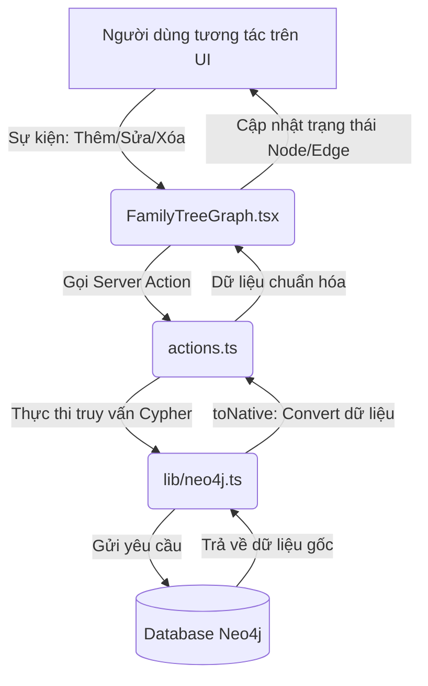

# Cấu Trúc và Kiến Trúc Dự Án (Digital Family Tree)

Tài liệu này mô tả chi tiết về cấu trúc thư mục, luồng dữ liệu và vai trò của các thành phần trong ứng dụng Cây gia phả kỹ thuật số.

---

## 🗺️ Bản Đồ Thư Mục (Directory Map)

```text
gia-pha-app/
├── src/
│   ├── app/                      # Next.js App Router (Logic chính)
│   │   ├── actions.ts            # Server Actions (Kết nối Neo4j, xử lý nghiệp vụ)
│   │   ├── globals.css           # Cấu hình Tailwind CSS v4 toàn cục
│   │   ├── layout.tsx            # Bố cục giao diện chung
│   │   └── page.tsx              # Trang chính (Dashboard và render Graph)
│   ├── components/
│   │   └── FamilyTreeGraph.tsx   # Sơ đồ gia phả tương tác (React Flow)
│   ├── lib/
│   │   └── neo4j.ts              # Cấu hình Driver & Helpers kết nối Neo4j
│   └── types/
│       └── family.ts             # Định nghĩa kiểu dữ liệu TypeScript
├── public/                       # Chứa tài nguyên tĩnh (hình ảnh, icon...)
├── app/                          # Thư mục app thừa (Cần cân nhắc dọn dẹp)
├── tsconfig.json                 # Cấu hình TypeScript (Alias: @/* -> ./src/*)
├── package.json                  # Các gói thư viện phụ thuộc (React Flow, Neo4j, Next.js...)
└── .env.local                    # Chứa biến môi trường (NEO4J_URI, USERNAME, PASSWORD...)
```

---

## 🛠️ Chi Tiết Các Thành Phần Chính

### 1. Cơ sở dữ liệu đồ thị (Neo4j Connection & Helpers)
* **Đường dẫn:** `src/lib/neo4j.ts`
* **Nhiệm vụ:**
  * Khởi tạo **Neo4j Driver Singleton** giúp tránh lỗi tạo trùng kết nối trong môi trường phát triển (do Hot Reloading).
  * Chuyển đổi dữ liệu tự động (`toNative()`) từ các cấu trúc phức tạp của Neo4j (ví dụ: kiểu Số nguyên đặc thù của Neo4j) sang các kiểu cơ bản của JavaScript (`number`, `string`, `object`).
  * Cung cấp hai helper `readQuery()` và `writeQuery()` để tương tác nhanh qua các transaction session.

### 2. Các hàm nghiệp vụ (Server Actions)
* **Đường dẫn:** `src/app/actions.ts`
* **Nhiệm vụ:** Đây là nơi trung gian kết nối Front-end và CSDL Neo4j:
  * `getFamilyTree()`: Đọc tất cả các nút người (`Person`) và các quan hệ giữa họ (`PARENT_OF`, `SPOUSE_OF`).
  * `upsertFamilyMember()`: Tạo mới hoặc cập nhật một thành viên. Tự động tính toán thế hệ (`generation`) của thành viên mới dựa vào người kết nối (con = thế hệ cha mẹ + 1; vợ/chồng = cùng thế hệ).
  * `deleteFamilyMember()`: Xóa thành viên kèm lệnh `DETACH DELETE` để tự động làm sạch các quan hệ liên kết đến nút đó.
  * `addRelationship()` & `deleteRelationship()`: Quản lý việc nối/gỡ các cạnh liên kết giữa các thành viên.
  * `seedDatabase()`: Khởi tạo nhanh dữ liệu mẫu 3 thế hệ của gia tộc họ Nguyễn để chạy thử ngay ứng dụng.

### 3. Giao diện Đồ thị Tương tác (React Flow Canvas)
* **Đường dẫn:** `src/components/FamilyTreeGraph.tsx`
* **Thư viện:** `@xyflow/react` (React Flow v12)
* **Nhiệm vụ:**
  * Hiển thị trực quan sơ đồ gia tộc với khả năng zoom, kéo thả canvas.
  * Tùy biến các Node (giao diện thẻ thành viên phân biệt nam/nữ, hiển thị ảnh đại diện, chức vụ, đời thứ mấy).
  * Tích hợp các nút hành động nhanh ngay trên Node để thêm Vợ/Chồng, thêm Con, Chỉnh sửa thông tin hoặc Xóa thành viên trực tiếp từ màn hình đồ thị.
  * Vẽ đường nối thể hiện quan hệ (nét liền cho con cái, nét đứt hoặc ký hiệu riêng cho vợ chồng).

### 4. Định nghĩa Kiểu dữ liệu (TypeScript Types)
* **Đường dẫn:** `src/types/family.ts`
* **Nhiệm vụ:** Đảm bảo an toàn kiểu dữ liệu (type safety) trong toàn bộ ứng dụng:
  * `FamilyMember`: Lưu trữ thông tin cá nhân.
  * `RelationshipType`: Chỉ chấp nhận hai loại liên kết `'PARENT_OF'` hoặc `'SPOUSE_OF'`.
  * `Relationship`: Xác định cạnh kết nối từ ai (`from`) tới ai (`to`) và thuộc kiểu quan hệ nào.

---

## 🔄 Luồng Dữ Liệu Hoạt Động (Data Flow)



---

## ⚠️ Khuyến Nghị Dọn Dẹp (Cleanup Recommendation)
Hiện tại dự án có cả thư mục **`app/`** ở ngoài root và **`src/app/`**. 
* Do ứng dụng đang chạy thực tế trên code của `src/app/` (alias `@/` được cấu hình trỏ vào `src/`), bạn nên kiểm tra kỹ và **xóa thư mục `app/` thừa ở thư mục gốc** để tránh gây hiểu nhầm hoặc xung đột định tuyến của Next.js.
