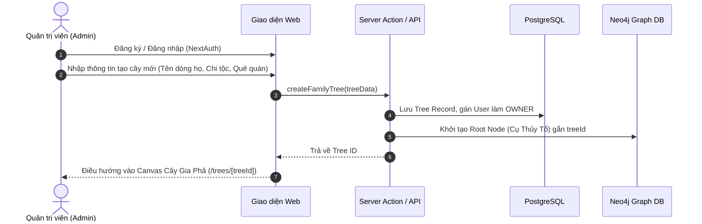

# 🏛️ Tổng Quan Dự Án Nền Tảng Cây Gia Phả (Family Tree SaaS)

## 1. Mục tiêu Dự án (Project Goals)
Nền tảng **Family Tree SaaS** là giải pháp phần mềm thương mại đa người dùng (Multi-tenant) chuyên nghiệp phục vụ quản lý, lưu trữ, nghiên cứu phả hệ và kết nối dòng tộc cho người Việt. Hệ thống kết hợp sức mạnh của **Cơ sở dữ liệu Đồ thị (Graph DB - Neo4j)** để xử lý quan hệ huyết thống phức tạp và **Cơ sở dữ liệu Quan hệ (PostgreSQL)** để quản lý người dùng, tài khoản, cây gia phả và phân quyền.

---

## 2. Đối tượng Người dùng (Target Audiences)
1. **Quản trị viên / Tộc trưởng (`ADMIN`)**: Người khởi tạo/quản lý cây gia phả, phân quyền thành viên, cấu hình quyền riêng tư, duyệt đề xuất chỉnh sửa từ con cháu và toàn quyền với phả đồ dòng họ.
2. **Người chép sử / Ban liên lạc (`EDITOR`)**: Nhập liệu, cập nhật tiểu sử, ngày giỗ, liên kết cha con, vợ chồng, đăng tải tư liệu dòng họ.
3. **Con cháu trong dòng họ (`MEMBER`)**: Đăng ký tài khoản, liên kết vào đúng vị trí của mình trên cây (*Claim Profile*), tự cập nhật thông tin cá nhân và gửi đề xuất bổ sung thông tin người thân.
4. **Khách viếng thăm / Công chúng (`VIEWER` / `PUBLIC`)**: Xem cây gia phả công khai theo chế độ bảo vệ quyền riêng tư (Privacy Masking).

---

## 3. Các Luồng Người dùng Chính (Core User Flows)

### 3.1. Luồng Khởi tạo & Thiết lập Cây Gia Phả

### 3.2. Luồng Nhập Liệu & Tương Tác Cây Gia Phả
- **Tạo thành viên trực tiếp trên đồ thị**: Click vào nút "+" tại thẻ thành viên để thêm Vợ/Chồng hoặc Con cái.
- **Nhập dữ liệu hàng loạt (Import Excel/CSV)**: Tải lên danh sách thành viên theo file mẫu; hệ thống tự động dựng cây và quan hệ trong vài giây.
- **Điều hướng & Lọc thông minh**:
  - Lọc theo **Chi / Cành / Nhánh** (ví dụ: Chi 1 Hà Nội, Chi 2 Hải Dương).
  - Lọc theo **Phạm vi thế hệ** (Ví dụ: Từ Đời 1 đến Đời 5).
  - Tìm kiếm thành viên theo Họ tên, Tên tự/Tên hiệu, Quê quán, Năm sinh/mất.

### 3.3. Luồng "Claim Profile" & Đề xuất chỉnh sửa từ Con Cháu
1. Thành viên mới đăng ký tài khoản $\rightarrow$ Tìm đến hồ sơ của mình trên cây $\rightarrow$ Nhấn **"Đây là tôi" (Claim Profile)**.
2. Quản trị viên nhận thông báo và nhấn **Duyệt**.
3. Thành viên được mở quyền cập nhật SĐT, nghề nghiệp, nơi ở hiện tại của chính mình; gửi đề xuất thêm con cháu mới sinh cho Ban quản trị duyệt.

---

## 4. Ba Chế Độ Hiển Thị (3 Core Views)
1. **Chế độ Đồ thị Tương tác (Interactive Graph Canvas)**: Render bằng `@xyflow/react` với thuật toán gom cụm vợ chồng và điểm nối hôn nhân thông minh.
2. **Chế độ Danh bạ Dòng tộc (Directory / Table View)**: Tra cứu danh sách có phân trang, lọc nâng cao, xuất Excel danh bạ.
3. **Chế độ Sách Phả Ký (Chronicle / Family Book View)**: Bố cục phả ký truyền thống theo từng đời từ trên xuống dưới, phù hợp đọc và in ấn sách gia phả.

---

## 5. Kế hoạch Xuất Dữ liệu (Export)
- Xuất phả đồ định dạng **Ảnh HD/Vector (PNG/SVG)** khổ lớn in treo nhà thờ họ.
- Xuất **Tập phả PDF** hoàn chỉnh các đời.
- Xuất danh bạ **Excel**.
